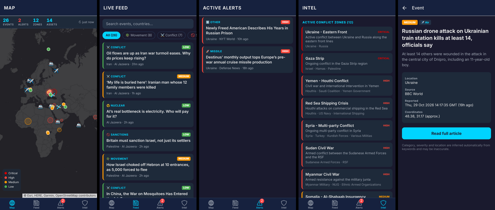

# Global Military Monitor — Mobile

iOS and Android companion app for the Global Military Monitor desktop dashboard, built with
Expo (React Native + TypeScript) and Expo Router.



## Features

- **Map** — dark world map (Leaflet + Esri tiles) with conflict zones, geolocated events colour-coded by
  severity (alerts pulse), and known military deployments. Tap an event for details.
- **Feed** — live news from GDELT and RSS (Defense News, BBC World, NYT World, Al Jazeera), filtered to
  military topics, with search and category filters.
- **Alerts** — high and critical severity events, with a badge count on the tab.
- **Intel** — active conflict zones, tracked assets, and the health of each data source.
- Pull to refresh, auto-refresh every 90 seconds while open, and the last snapshot is cached for
  instant start-up and offline viewing.

## Running it

Requires Node 20+.

```bash
cd mobile
npm install
npx expo start
```

Then scan the QR code with **Expo Go** ([iOS](https://apps.apple.com/app/expo-go/id982107779) /
[Android](https://play.google.com/store/apps/details?id=host.exp.exponent)), or press `i` / `a` to open an
iOS simulator / Android emulator.

## Building installable apps

Use [EAS Build](https://docs.expo.dev/build/introduction/) (no Xcode/Android Studio needed):

```bash
npx eas-cli@latest login
npx eas-cli@latest build --platform android   # .apk/.aab
npx eas-cli@latest build --platform ios       # needs an Apple Developer account
```

## Checks

```bash
npm run typecheck
npx expo lint
npm test          # unit tests for categorisation / severity / geolocation
```

## Code layout

```
src/
├── app/                  # Expo Router screens
│   ├── _layout.tsx       # root stack + data provider
│   ├── (tabs)/           # Map, Feed, Alerts, Intel tabs
│   └── event/[id].tsx    # event detail (modal)
├── components/           # EventCard, EventList, WorldMap (WebView on native, iframe on web)
├── lib/
│   ├── classify.ts       # keyword categorisation, severity and geolocation (ported from the desktop feeds)
│   ├── feeds.ts          # GDELT + RSS fetching/parsing
│   ├── aggregator.ts     # runs feeds in parallel, dedupes and sorts
│   └── seed.ts           # conflict zones and known deployments (OSINT reference data)
├── state/MonitorProvider.tsx  # polling, caching, refresh
└── theme.ts              # colours matching the desktop dark theme
```

## Notes and limitations

- Categories, severity and locations are inferred from keywords, as in the desktop app, so expect
  occasional misclassifications. Unlike the desktop app, events with no recognisable location are shown in
  the feed but not placed on the map at random coordinates. Severity "Critical" now requires a weapons
  context, so articles about nuclear power no longer raise alerts.
- GDELT allows one request every 5 seconds per IP and returns HTTP 429 beyond that. Its status shows on the
  Intel tab; the other feeds keep working.
- Asset positions are static OSINT reference data. Live ADS-B tracking needs an API key from a provider and
  isn't wired up yet.
- The web build (`npx expo start --web`) renders, but browsers block the cross-origin RSS/GDELT requests
  (CORS), so live data only works in the native apps.
